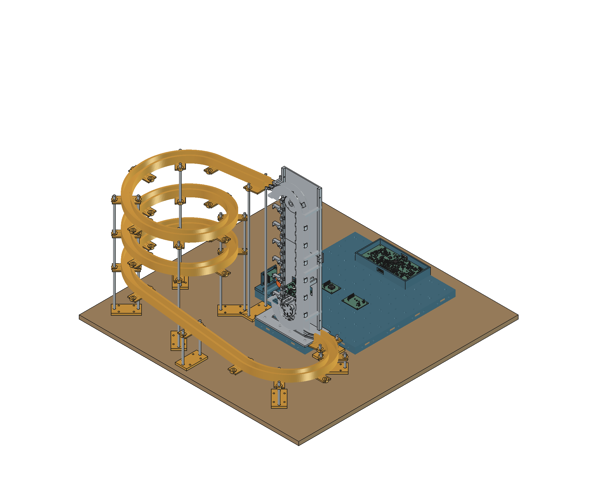
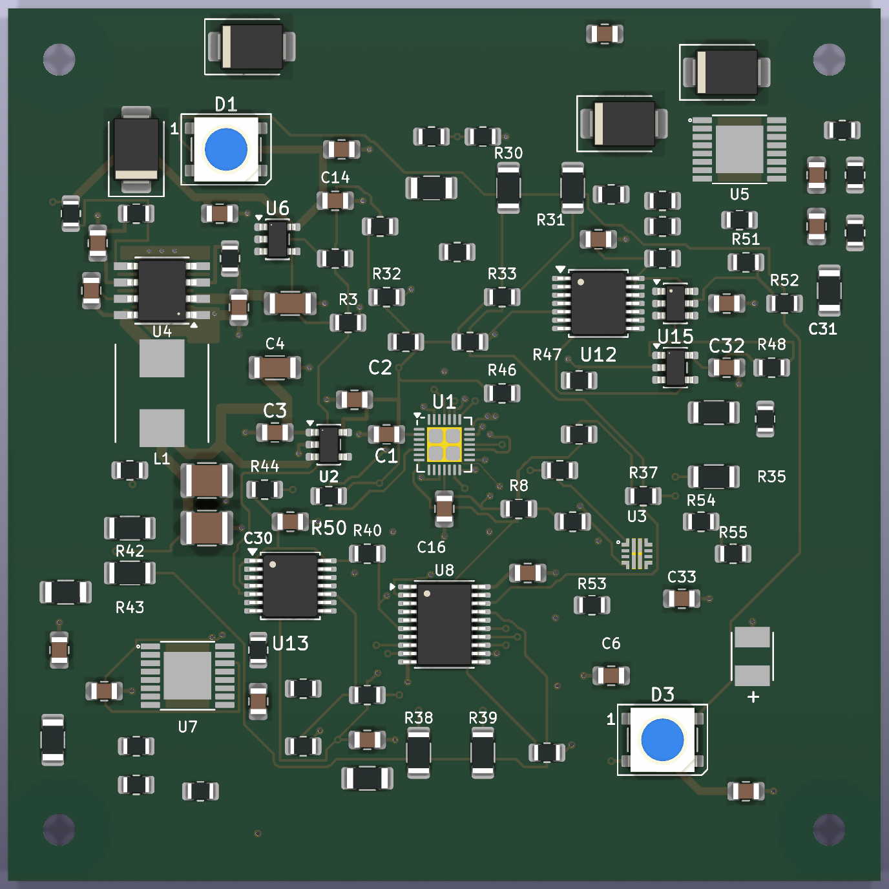
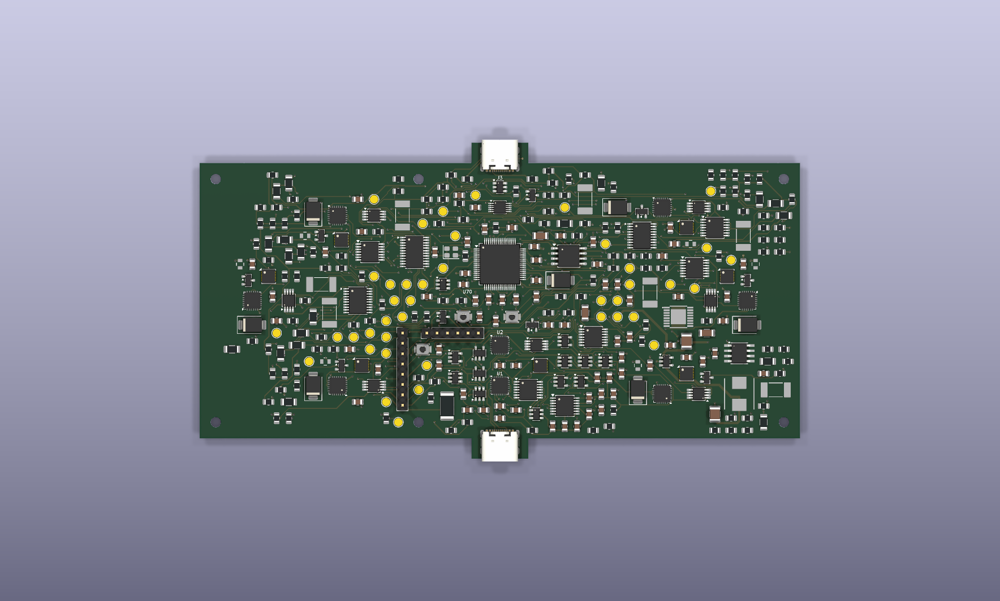
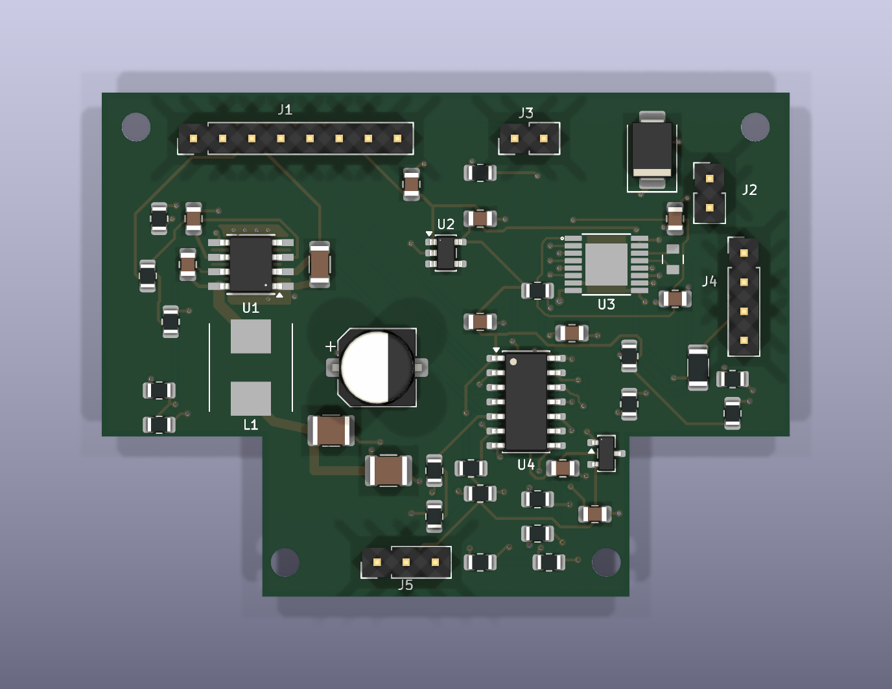
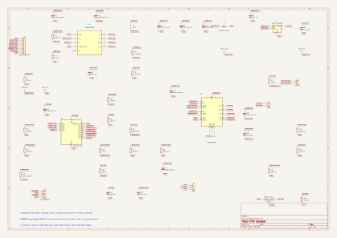

# Klink

Klink is an 80x80mm magnetic tile system for programmable marble runs. V1 keeps sixteen identical intelligent tiles, a six-port Hub, removable modules and a motorized elevator for continuous circulation. Sensors, buttons, RGB LEDs and a gate let a program react to marbles and people.

The design is in progress. It is not ready for main-board fabrication or Fallen Design Submission. The remaining digital work and physical qualification gates are listed below.

TODO: Add the participant's own explanation of why they are making Klink. Personal design narrative, journals and demonstrations must describe their actual work.

## Operation

A USB-C PD supply feeds a 20V bus through the Hub's independent protection and common shutdown. Each tile makes local 5V and 3.3V, has four independent UART links, two RGB LEDs and protected module supplies. Local 5V rails never connect between tiles. The Hub's input cutoff is approximately 4.2A nominal; accepting a 100W adapter does not guarantee 100W delivered to tiles.

Buildable firmware provides discovery, hardware-UID identification, address assignment, topology reporting, framed/CRC-protected routing, module identification, power leases, RGB/PWM/I2C access and fault handling. The Hub stores a small event program and its tile bindings for standalone operation. A POSIX USB commissioning client is included. The elevator controller has default-off motor control, progress/current monitoring, a normally closed stop and latched fault recovery. None of these images has run on assembled Klink hardware.

After hardware qualification, commission known modules and upload rules over the separate USB data port. The stored program can run without a permanently connected computer. Protocol capacity targets 64 tiles; permissible power depends on topology and admitted loads. Disconnect bus power before rearranging tiles.

## Design views

[FreeCAD assembly source](hardware/cad/assembly.FCStd) includes the electronics, lift, return, gate, support rods and baseboard. Some component models, input-module cases, connectors and harnesses remain incomplete. This is a CAD reference, not a photograph or a full collision qualification.

Tile placement and partial routing. The MCU and several custom parts have missing 3D models. [Copper plot](docs/images/tile.svg).

Hub placement and partial routing. All 350 schematic circuit references are represented on the PCB; routing remains incomplete. [Copper plot](docs/images/hub.svg).

The elevator layout is fully connected and passes native DRC. Electrical/thermal bring-up remains necessary.

## Files

- [Editable KiCad projects and board BOMs](hardware/electronics/).
- [CAD sources, individual STEP/STL exports and assembly notes](hardware/cad/README.md).
- [Manufacturing drafts, Gerber ZIPs, drills, BOM/CPL and validation summary](hardware/manufacturing/README.md).
- [Firmware source, offline build instructions, tests and USB client](firmware/README.md).
- [Consolidated purchase/funding BOM](bom.csv) and [cost basis](docs/specifications/BOM.md).
- [Electrical design](docs/specifications/rev-a.md), [interfaces and orientation](docs/specifications/interfaces.md), and [prototype tests](docs/specifications/prototype-plan.md).

## Validation and funding

Native KiCad 10.0.8 ERC passes on all six circuit schematics. Elevator, button, sensor and gate have zero physical DRC violations, unconnected items or schematic-parity errors. Tile and Hub have zero physical DRC violations, but still have 117 and 407 unconnected items respectively. Tile J3-J7 have no released footprints. Those boards have no fabrication package. The [summary](hardware/manufacturing/validation.json) records source hashes and the incomplete state.

All three MCU targets compile. Host C protocol/safety tests pass with address and undefined-behavior sanitizers, alongside the Python client tests. Closed individual print meshes and STEP exports have been checked; physical fit, loads, temperature, signal integrity and protection transients remain untested.

The complete sixteen-tile worksheet is approximately USD 1,444.09 plus a separately identified USD 361.02 uncertainty allowance, or USD 1,805.11. This is not a verified supplier quote or approved grant amount. Many parts/services still use clearly marked allowances, and some material rows still need exact purchase SKUs/links. TPS26630 is out of stock at the checked LCSC listing; TPS259470 stock is insufficient for the kit. The 3/5-tile trial estimates are separate and should not be added to the sixteen-tile total. Owned PETG and tools are not charged again.

## Before submission and manufacturing

Finish the remaining tile/Hub routing, power/return and USB layout review, missing models and fabrication checks. Qualify edge/top contacts and their fault transients before releasing connector geometry. Complete the module cases, optical mounts, harnesses and interactive marble route against that interface. Obtain delivered parts/assembly quotes and replace provisional material links and allowances.

This revision includes AI assistance with firmware, engineering edits, checks and exports. The participant must add their own original design explanation and genuine journals, review the design and publish the reviewed revision. Approval and funding eligibility are not established by the files in this repository. After funding, follow the current-limited contact/protection, PCB bring-up, print-fit, sensor, gate, motor and continuous-run tests in the prototype plan. No build photographs or successful hardware tests are claimed.
